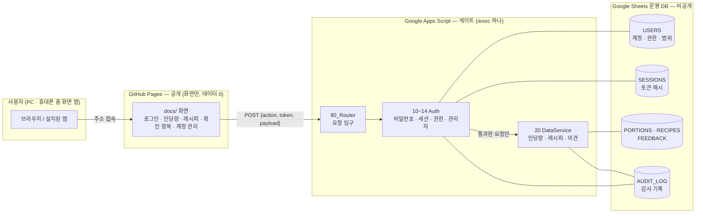
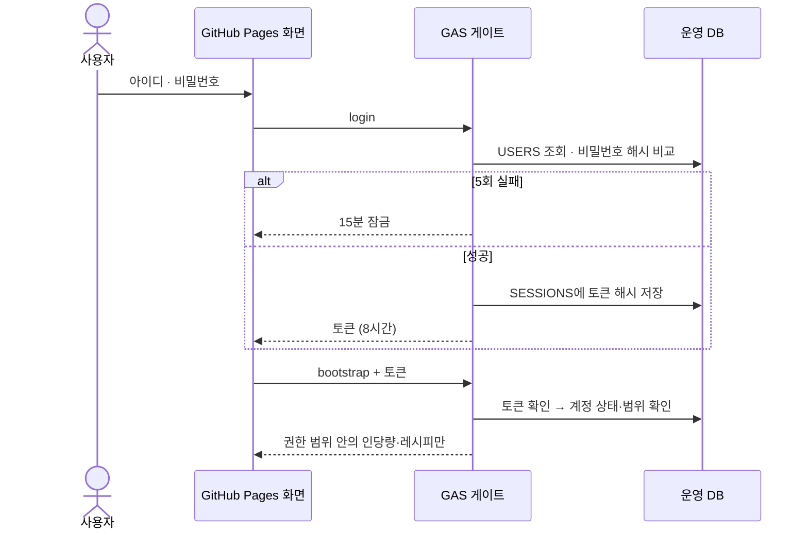
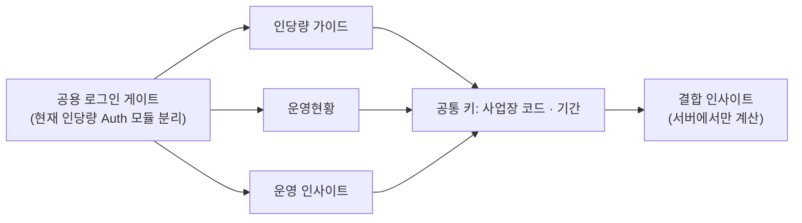

# 인당량 가이드 v3 — 최종 설계도 (2026-11-25)

## 1. 한눈에 보기

## 2. 로그인과 데이터 요청 흐름

## 3. 구성 요소

| 구성 | 위치 | 역할 | 공개 |
|---|---|---|---|
| 화면 | GitHub `portion-recipe` 저장소 `docs/` → Pages | 화면 틀만. 로그인 후 데이터를 받아 표시 | 공개 (데이터 없음) |
| 게이트 | Apps Script "WELLSTORY 인당량 가이드 개인시험" (구 시험 시트에 연결된 프로젝트) | 로그인·권한 판단, 데이터 제공 | 비공개 (코드만 GitHub에) |
| 운영 DB | "화성지역 인당량·통합 레시피 운영DB v2 — 개인시험" | 계정·세션·업무 데이터·감사 기록 | 비공개 |
| 개발 폴더 | PC `웰스토리\인당량&레시피\인당량_Pages_v3` | 원본 코드·시험·배포 도구 | 본인 PC |

## 4. 보안 설계

| 위협 | 대응 |
|---|---|
| GitHub 공개로 자료 유출 | 화면에 데이터 없음, 공개 폴더 자동 유출 검사(GitHub Actions) |
| 서버 주소가 알려짐 | 토큰 없으면 모든 데이터 요청 거부 |
| 시트 열람으로 비밀번호 노출 | PBKDF2 해시만 저장(원문 없음), 세션도 토큰 해시만 저장 |
| 비밀번호 대입 공격 | 5회 실패 → 15분 잠금, 실패·잠금 감사 기록 |
| 퇴사자·분실 | 관리자 화면에서 정지 → 다음 요청부터 즉시 차단 |
| 권한 밖 사업장 조회 | 서버에서 siteScope로 걸러서 전송 |
| 관리자 기능 오용 | ADMIN만 호출 가능, 자기 정지·마지막 관리자 해제 불가 |
| 시트 수식 주입 | `=`,`+`,`@`,`-`로 시작하는 입력은 텍스트로 저장 |

## 5. 운영 흐름

| 일 | 어디서 | 문서 |
|---|---|---|
| 새 사람 추가·비밀번호 지정·정지 | 앱 [⚙ 계정 관리] | [02_계정관리](02_계정관리.md) |
| 휴대폰 설치 | 휴대폰 브라우저 | [04_모바일설치](04_모바일설치.md) |
| 화면 수정 배포 | PC → `git push` | [01_배포절차](01_배포절차.md) |
| 서버 수정 배포 | PC → `.\tools\deploy-gas.ps1 -Deploy` | [01_배포절차](01_배포절차.md) |
| 관리자 복구 | Apps Script 편집기 `recoverAdmin` | [02_계정관리](02_계정관리.md) |
| 되돌리기 | 배포 관리에서 이전 버전 / `git revert` | [01_배포절차](01_배포절차.md) |

## 6. 확장 방향 (최종 목표)

선결 과제: 사업장 코드 체계 통일, 역할 세분화(지역·현장·지원부서), 사내 보안 승인. 상세는 [03_확장설계](03_확장설계.md).
